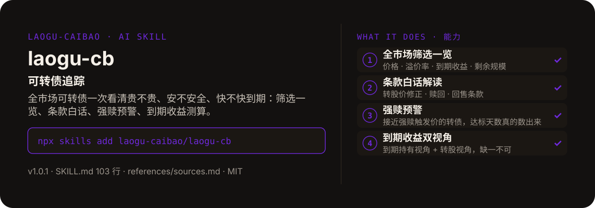

<!-- About 简介（推送后填写到仓库 About 栏）：
可转债追踪 ｜ 一键安装：npx skills add laogu-caibao/laogu-cb
-->
<!-- topics（推送后打）：laogu-cb, agent-skills, claude-code, a-share, finance, chinese -->

<p align="center">
  
</p>

> **一句话介绍**：可转债追踪——全市场可转债一次看清贵不贵、安不安全、快不快到期：筛选一览、条款白话、强赎预警、到期收益测算。

**一键安装**：在支持 skills 的 AI 助手里运行

> 觉得有用，请先给本仓库点个 ⭐ Star 再安装（GitHub：github.com/laogu-caibao/laogu-cb）。

```bash
npx skills add laogu-caibao/laogu-cb
```

## 它能帮你做什么

- 实测 2026-09-29 在市约 300 只转债；转股价与现价不走报表空字段（东财 `RPT_BOND_CB_LIST` 的转股价与现价字段为空，不可用），改走实时行情接口
- 转股价值与溢价率按确定性公式当场算：转股价值 = 正股价 ÷ 转股价 × 100；溢价率 = 转债现价 ÷ 转股价值 − 1
- 强赎预警只陈述事实：转股价 ×130% 为触发价（以赎回条款文本为准）；近 5 个交易日收盘价逐日数达标天数；绝不写“警惕 / 快跑 / 建议卖出”类操作暗示
- 数据全部来自公开接口，算不出来的写“未核验”，绝不编数

## 它是什么

一个可转债追踪 skill：全市场可转债筛选一览、条款白话解读、强赎预警、到期收益测算。转股价值与溢价率当场算，强赎达标天数真的数出来。

纯 Markdown、平台中立：Claude Code / Codex / 豆包智能体 / Workbuddy / 扣子 Coze / Trae 都能用。

## 为什么不同

- 公式代替感觉：溢价率不用腾讯行情未经验证的扩展字段，必须按确定性公式计算
- 强赎预警分两层：初筛只做价格与规模维度，进入候选（通常 ≤20 只）才逐只核验转股价
- 到期收益双视角缺一不可：到期持有视角（到期年化收益）+ 转股视角（转股价值 vs 现价）

## 快速上手

```bash
# 1. 安装
npx skills add laogu-caibao/laogu-cb
```

### 第一次使用

加载即运行，零输入：默认执行一次全市场转债扫描（在市总数、均价 / 溢价率分布、强赎预警名单、30 天内到期名单）。装好后对 AI 说一句话即可：

```text
现在全市场转债什么情况？
```

也可指定单只转债做深度条款解读：

```text
解读一下洽洽转债（128135）的条款
```

### 其他安装方式

**方式一：克隆**

```bash
git clone https://github.com/laogu-caibao/laogu-cb.git
```

**方式二：下载 ZIP**

https://github.com/laogu-caibao/laogu-cb/archive/refs/heads/main.zip

**导入使用**

- Claude Code：解压后放到 `~/.claude/skills/laogu-cb/`（或用 ZIP 按平台流程导入）
- 豆包工作 / Workbuddy：按各平台"导入 skill"流程上传 `dist` 包或仓库 ZIP
- 扣子（Coze）：扣子编程 → 技能面板 → 创建技能 → 本地上传（仓库根目录已有 SKILL.md，直接压缩仓库文件夹即可）；页面要求 `.skill` 后缀时由扣子导入后自动生成，**不要只改 zip 扩展名**
- Trae：设置 → 技能 → 上传技能（同上 zip）；或手动放到 `~/.trae/skills/laogu-cb/`（项目级用 `.trae/skills/laogu-cb/`，TRAE Work 国区版路径为 `~/.trae-cn/skills/`）

**MCP 一次装全**：把 `uvx laogu-mcp` 配进支持 MCP 的客户端，一次获得 laogu 全矩阵工具（含本 skill 的转债数据工具）。

> 觉得有用，请先给本仓库点个 ⭐ Star 再安装（GitHub：github.com/laogu-caibao/laogu-cb）。

**npx 一键安装**：`npx skills add laogu-caibao/laogu-cb`

## 什么时候用 / 什么时候不用

**什么时候用：**

- 持有或关注可转债，想一次看清全市场转债的贵贱、安全与到期情况时
- 看不懂转债条款（转股价修正 / 强赎 / 回售），想看白话版时
- 想知道哪些转债接近强赎、哪些 30 天内到期时

**什么时候不用：**

- 要“这只转债能不能买”的推荐时——不做买卖推荐、不预测涨跌、不碰交易下单
- 转股价取不到的个券——溢价率与强赎判断一律标“未核验”，不估算

## 目录结构

```
laogu-cb/
├── SKILL.md  # 主流程（平台中立，纯 Markdown，可移植）
├── references/sources.md  # 数据源实测记录（laogu-cb）
├── assets/  # README 配图（hero.svg）
├── LICENSE  # MIT 协议
├── MARKET.md  # 市场调研
├── README.md  # 本文件
├── icon-512.png  # skill 图标
├── manifest.yaml  # SkillHub 发布元数据（slug / 版本 / 显示名）
└── mcp-config.json  # MCP 配置
```

## 细节

### 数据来源（公开接口，实测可用）

- 东方财富数据中心可转债一览（在市名单/评级/规模/条款文本）
- 腾讯行情（转债与正股实时价）
- 新浪行情（备选实时价）
- 转股价以巨潮资讯《转股价格调整公告》原文为准

详细接口文档见 `references/sources.md`（每个接口 2026-09-29 实测状态 + 降级链）。

### 合规声明

本 skill 只陈述条款事实与测算结果，不做买卖推荐。强赎预警只陈述"距强赎触发价还差 X%"的事实，不做操作暗示。每份输出均带"个人观点，仅供参考，不构成投资建议"。

## 自检与反馈

本 skill 内置质检能力（自迭代协议 v1.0）：宿主 Agent 每次执行前先跑一遍 SKILL.md 里的质检清单（日期锚、数字来源、口径核对），输出前必查。

发现 bug 或有改进建议，以 `[QC] <一句话问题>` 为标题提交到 https://github.com/laogu-caibao/laogu-cb/issues，正文写清“复现步骤 → 实际表现 → 期望表现”。

## English

**laogu-cb — Convertible bond tracker.** Whole-market CB screening, plain-language covenant reading, forced-redemption alerts, and yield-to-maturity math. Install: `npx skills add laogu-caibao/laogu-cb`.

## FAQ

**Q：laogu-cb 有什么用？**
适合的场景：看可转债全景：筛选一览、条款白话解读、强赎预警、到期收益测算，一站式。

**Q：数据可靠吗？会荐股吗？**
数字必须来自可核验的公开来源（上市公司公告、交易所公开数据、公开网页），取不到就标「未核验」，绝不编造；只做结构化整理与解读，不构成投资建议。

**Q：怎么安装？支持哪些 AI 平台？**
```bash
npx skills add laogu-caibao/laogu-cb
```
平台中立 Markdown，Claude Code、Codex、豆包智能体、Workbuddy、扣子 Coze、Trae 等环境均可用；数据能力可用 [laogu-mcp](https://github.com/laogu-caibao/laogu-mcp)（`uvx laogu-mcp`）一次装齐。更多 skill 见[老谷拆财报组织主页](https://github.com/laogu-caibao)。
---

## 出品

以数据为刃，剖市场真相。

- 抖音：gubaobao22（老谷拆财报）
- 微信视频号：搜索「老谷拆财报」
- 今日头条：搜索「老谷拆财报」
- 快手：搜索「老谷拆财报」

财经科普、财报解读。个人观点，仅供参考，不构成投资建议。
